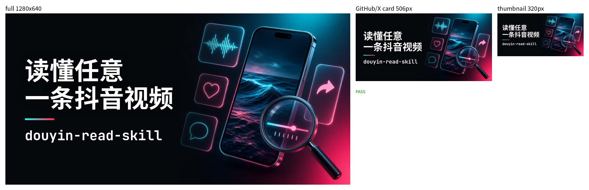
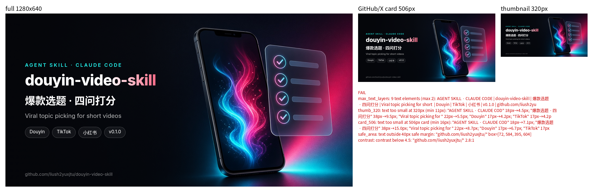

# github-social-preview-ai — AI GitHub Social Preview / OG Image Generator (Agent Skill)

[](LICENSE) [](SKILL.md) [](https://github.com/liush2yuxjtu/github-social-preview-ai)

**Generate crisp GitHub social preview images (repo cover / Open Graph image, 1280×640) with text-free AI art + real-font HTML typography — an Agent Skill for Claude Code, Cursor, Codex and other coding agents.**

[English](#english) · [中文](#中文)


## English

### Why
- Image models garble text, so the background is **text-free AI art** and text is composed in **HTML + headless Chrome** with real fonts (excellent CJK support).
- **Max 2 text layers** (headline + repo name), readable at **320×160** thumbnail size; a `.thumb.png` is generated for checking.
- Reserved clean **text zone + scrim** so text never overlaps the art.
- **Batch** many repo covers from one `covers.json`.

### Install
```sh
# Claude Code (personal skills)
git clone https://github.com/liush2yuxjtu/github-social-preview-ai ~/.claude/skills/github-social-preview-ai
# project-level: .claude/skills/  ·  other agents: .agents/skills/ or .cursor/skills/
# or: npx skills add liush2yuxjtu/github-social-preview-ai
```
Requirements: Python 3 + Pillow, Google Chrome / Chromium, a CJK font (e.g. Noto Sans CJK).

### Usage
Ask your agent: *"Make a GitHub social preview for this repo"*. Or run directly:
```sh
python3 scripts/render.py examples/covers.json --out-dir out   # renders + verifies, exit 1 on FAIL
python3 scripts/verify.py out/my-repo.png                      # verify a single cover
```
```json
{"defaults": {"art_shift": 60, "accent": ["#25f4ee", "#fe2c55"]},
 "covers": [{"out": "my-repo.png", "bg": "bg/my-repo.jpg", "headline": ["One line", "that says it"], "title": "my-repo"}]}
```
Then upload in **Settings → General → Social preview**.

## 中文

**github-social-preview-ai**：用「无文字 AI 背景图 + HTML 真字体排版」生成 GitHub 仓库封面（Social Preview / OG 图，1280×640）的 Agent Skill，适用于 Claude Code、Cursor、Codex 等。

### 为什么
- 图像模型写字会糊 → 背景用**无文字 AI 图**，文字用 **HTML + 无头 Chrome** 真字体排版（中文友好）。
- **最多两层文字**：大标题 + 仓库名，缩到 **320×160** 依然清晰（自动输出缩略图供检查）。
- 左侧预留干净文字区 + 渐变遮罩，文字不压图。
- 一份 `covers.json` 批量出图。
- **自动校验**（`scripts/verify.py`，每次渲染后自动运行）：文字层 >2、320px 缩略图下字号 <11px / 506px 卡片下 <16px、越出 40px 安全边距、压到插画、对比度 <4.5、缩略图 OCR 认不出标题——任何一项都会失败并给出原因，同时输出报告 JSON 和对比图（原图 | 506 | 320）。

### Verifier in action / 校验示例
Passing cover / 通过：

An earlier cluttered draft — rejected automatically / 早期杂乱版本被自动拒绝（[full output](examples/fail-demo/verify-output.txt)）：


### 安装
同上 `git clone` 到 `~/.claude/skills/`（或 `.agents/skills/`、`.cursor/skills/`），或 `npx skills add liush2yuxjtu/github-social-preview-ai`。依赖：Python 3 + Pillow、Chrome/Chromium、中文字体（如 Noto Sans CJK）。

### 用法
对 agent 说：*"给这个仓库做个 GitHub 封面"*，或直接运行 `python3 scripts/render.py examples/covers.json --out-dir out`，然后在仓库 **Settings → Social preview** 上传。

## Cite / 引用
If this skill helps your work, please cite it (see [`CITATION.cff`](CITATION.cff), or GitHub's "Cite this repository" button). / 如有帮助，欢迎通过 `CITATION.cff` 引用。

## Credits / 致谢
Inspired by [sjh9714/repo-cover](https://github.com/sjh9714/repo-cover) (CJK-first HTML cards, deterministic checks) and the [og-image skill in prompt-to-asset](https://github.com/MohamedAbdallah-14/prompt-to-asset/blob/main/.claude/skills/og-image/SKILL.md) ("never let diffusion draw the text").

## License
[MIT](LICENSE)
